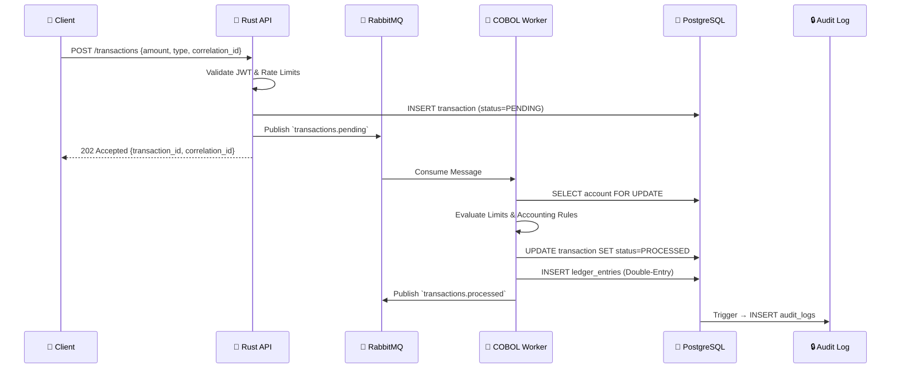
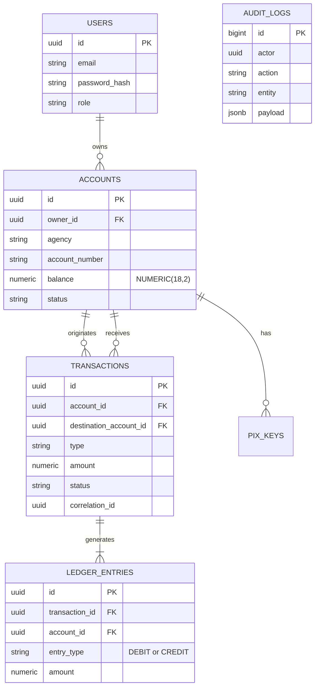

<div align="center">
  
# 🏦 System-Bank

**An event-driven core banking simulation bridging modern Rust microservices with legacy COBOL batch processing.**

[](https://github.com/CaioSouzx00/System-Bank/actions/workflows/ci.yml)


</div>

---

## 📖 Overview

**System-Bank** is a comprehensive core banking simulation engineered to demonstrate how modern distributed backends integrate with legacy mainframe infrastructure. 

In the financial industry, a significant volume of global transactional data still routes through COBOL batch processing systems due to their proven reliability. This project provides a hands-on architectural reference for engineers building bridging systems, demonstrating how to expose legacy logic through a modern Rust-based API while maintaining strict transactional guarantees, idempotency, and auditability.

---

## ✨ Key Capabilities

*   🏦 **Account Management:** Bank account provisioning with automated routing and check digit generation.
*   ⚡ **Asynchronous Transactions:** Event-driven processing for debits, credits, transfers, and fees using RabbitMQ.
*   ⚖️ **Idempotency & Double-Entry Accounting:** Strict accounting rules enforced per transaction, eliminating race conditions and rounding errors.
*   💸 **PIX Integration:** Simulated Brazilian instant payment system (PIX), featuring key registration (CPF, email, phone, random) and QR Code generation.
*   🔒 **Immutable Audit Logs:** Append-only auditing enforced at the database layer via PostgreSQL triggers.
*   📼 **COBOL Batch Processing:** Legacy orchestration for end-of-day closing, interest calculation, fee processing, and reconciliation.
*   📄 **Statement Generation:** Export financial statements in JSON or standard Open Finance/OFX formats.
*   🛡️ **Robust Security:** JWT (RS256 asymmetric signatures), Role-Based Access Control (RBAC), and Argon2id password hashing.
*   📊 **Comprehensive Observability:** Distributed tracing, structured logging, and monitoring via OpenTelemetry, Loki, Tempo, and Grafana.

---

## 🏗️ Architecture

The system is decoupled into specific layers communicating asynchronously, ensuring eventual consistency, fault tolerance, and isolation.

| Component | Technology | Responsibility |
| :--- | :--- | :--- |
| **API Gateway & Routing** | 🦀 Rust (Axum) | Authentication, request validation, rate limiting, and webhook termination. |
| **Message Broker** | 🐇 RabbitMQ | Async decoupling, retries, and dead-letter queues. |
| **Batch Processing** | 📼 GnuCOBOL 3.2 | Financial consolidation, reconciliation, and legacy batch jobs. |
| **Persistence Layer** | 🐘 PostgreSQL 16 | ACID-compliant storage, double-entry ledger, and immutable audit logs. |
| **Observability Stack** | 🔭 OTel, Loki, Grafana | Distributed tracing, log aggregation, and real-time operational metrics. |

### 🔄 Transaction Lifecycle Flow



---

## 🧠 Core Banking Concepts Demonstrated

*   🔄 **Idempotent API Design:** Clients provide a `correlation_id` (UUID). The API validates this against existing transactions to prevent duplicate processing during network retries.
*   📡 **Event-Driven Processing:** Decoupling the API from synchronous processing prevents database row locks (`SELECT FOR UPDATE`) from exhausting connection pools under heavy concurrent load.
*   ⚖️ **Double-Entry Ledger:** Every financial movement generates exactly two entries (a debit and a credit), guaranteeing that the net sum of all movements equals zero.
*   📬 **Dead-Letter Queues (DLQ)::** Messages exceeding the maximum retry threshold (3 attempts) are routed to a DLQ for operational review and manual replay.
*   🌉 **Legacy Integration Pattern:** The modern Rust service orchestrates the COBOL worker, generating standard input files and parsing output results, abstracting the legacy engine from external consumers.

---

## 💾 COBOL Integration

The `batch-cobol` module represents the core business logic often found in legacy banking mainframes. The Rust worker spawns GnuCOBOL binaries as subprocesses, simulating how modern microservices bridge the gap with legacy batch jobs.

*   🌙 `DAILY-CLOSING.cbl`: End-of-day account balance consolidation.
*   📈 `INTEREST-CALC.cbl`: Daily compounding interest calculation for negative balances.
*   📁 `CNAB240-GEN.cbl`: Generates standard CNAB 240 layout files for inter-bank clearing.
*   🔍 `RECONCILIATION.cbl`: Audits discrepancies between the `transactions` table and `ledger_entries`.
*   🧾 `FEE-CALC.cbl`: Applies dynamic operational fees based on transaction types.
*   🏛️ `REGULATORY-REPORT.cbl`: Batch regulatory reporting for BACEN SCR (Doc 3040 Credit Risk) and PSTAW10 (Payment Scheme Net Settlement).

---

## 🗄️ Data Model

The PostgreSQL schema enforces strict data integrity constraints.

### Entity-Relationship Diagram



*   **`accounts`**: Stores account metadata and current balances. `balance` utilizes `NUMERIC(18,2)`—never floating-point types—preventing monetary rounding errors.
*   **`transactions`**: Tracks the state of user-initiated movements (`PENDING`, `PROCESSED`, `FAILED`).
*   **`ledger_entries`**: Immutable records of debits and credits adhering to double-entry rules.
*   **`audit_logs`**: An append-only table. A PostgreSQL trigger forcibly rejects any `UPDATE` or `DELETE` commands, satisfying stringent compliance requirements.
*   **`batch_jobs`**: Job tracking for COBOL worker executions.
*   **`pix_keys`** & **`users`**: Identity, authentication, and PIX routing tables.

---

## 🔐 Security & Compliance Simulation

The architecture integrates principles derived from financial compliance standards (e.g., PCI-DSS):

*   🔑 **Authentication:** JWT signed with RS256. Private keys are isolated; the API only holds the public key for verification.
*   🌐 **Encryption in Transit:** Strict TLS 1.3/mTLS configurations simulated between the Rust API and worker boundaries.
*   📦 **Data at Rest:** Sensitive configurations are strictly injected via environment variables.
*   👮 **Role-Based Access Control:** Granular `CLIENT`, `OPERATOR`, and `ADMIN` roles govern endpoint access.
*   🛡️ **Immutability:** Audit trails cannot be altered by application logic or database administrators without circumventing hard triggers.

---

## 📂 Repository Structure

```text
system-bank/
├── api-rust/          # 🦀 Modern API Layer (Rust, Axum, OpenTelemetry)
├── app-flutter/       # 📱 Modern Flutter Mobile, Tablet & Web Client
├── batch-cobol/       # 📼 Legacy Processing Engine (GnuCOBOL 3.2)
├── migrations/        # 🐘 Sequenced PostgreSQL schema migrations
├── infra/docker/      # 🐳 Container orchestration (RabbitMQ, Postgres, OTel, etc.)
├── scripts/           # 📜 CI/CD and operational bash utilities
└── docs/              # 📚 Architecture Decision Records (ADRs) and diagrams
```

---

## 🚀 Getting Started

### Prerequisites

*   🐳 Docker (24.x+) and Docker Compose (v2.x)
*   📼 GnuCOBOL 3.2 (Optional, for local COBOL development)
*   🦀 Rust 1.78+ (Optional, for local API development)

### Running the Environment

1.  **Clone the repository:**
    ```bash
    git clone https://github.com/CaioSouzx00/System-Bank.git
    cd System-Bank
    ```

2.  **Configure the environment:**
    ```bash
    cp infra/docker/.env.example infra/docker/.env
    # A pre-configured development RSA public key is already included for RS256 JWT validation.
    # To generate new TLS mTLS certificates and RSA key pairs:
    bash scripts/generate-certs.sh
    bash scripts/generate-jwt-keys.sh
    ```

3.  **Deploy the infrastructure:**
    ```bash
    docker compose -f infra/docker/docker-compose.yml up -d
    ```

4.  **Run database migrations:**
    ```bash
    bash scripts/run-migrations.sh
    ```

### API Examples

Once the environment is running (`http://localhost:8080`), you can interact with the API:

**Check Health:**
```bash
curl http://localhost:8080/health
```

**Create an Account:**
```bash
curl -X POST http://localhost:8080/accounts \
  -H "Authorization: Bearer <JWT_TOKEN>" \
  -H "Content-Type: application/json" \
  -d '{"agency": "0001"}'
```

**Initiate a Transaction (Idempotent):**
```bash
curl -X POST http://localhost:8080/transactions \
  -H "Authorization: Bearer <JWT_TOKEN>" \
  -H "Content-Type: application/json" \
  -d '{
    "account_id": "<ACCOUNT_UUID>",
    "type": "DEBIT",
    "amount": "150.00",
    "correlation_id": "<UNIQUE_UUID>"
  }'
```
*Note: Returns `202 Accepted` immediately. Processing occurs asynchronously.*

**Register a PIX Key:**
```bash
curl -X POST http://localhost:8080/pix/keys \
  -H "Authorization: Bearer <JWT_TOKEN>" \
  -H "Content-Type: application/json" \
  -d '{"key_type": "Email", "key_value": "user@example.com"}'
```

**Generate an OFX Statement:**
```bash
curl "http://localhost:8080/accounts/<ACCOUNT_UUID>/statement?from=2024-01-01&to=2024-01-31&format=ofx" \
  -H "Authorization: Bearer <JWT_TOKEN>"
```

**Simulate Compound Interest:**
```bash
curl "http://localhost:8080/accounts/<ACCOUNT_UUID>/interest-simulation?days=30&annual_rate=12.0" \
  -H "Authorization: Bearer <JWT_TOKEN>"
```

**Generate BACEN Regulatory Reports (SCR Doc 3040 & PSTAW10):**
```bash
# BACEN SCR Doc 3040 XML
curl "http://localhost:8080/regulatory/scr?base_date=2024-01-31&format=xml" \
  -H "Authorization: Bearer <JWT_TOKEN>"

# BACEN PSTAW10 JSON
curl "http://localhost:8080/regulatory/pstaw10?base_date=2024-01-31&format=json" \
  -H "Authorization: Bearer <JWT_TOKEN>"
```

**Access Operational Reconciliation Dashboard:**
```bash
# JSON Reconciliation Metrics
curl "http://localhost:8080/operations/reconciliation/metrics" \
  -H "Authorization: Bearer <JWT_TOKEN>"

# Interactive Web UI Dashboard
# Open in browser: http://localhost:8080/operations/reconciliation/dashboard
```

### Manual Batch Execution

To manually trigger a COBOL batch job within the worker container:

```bash
docker compose -f infra/docker/docker-compose.yml exec cobol-worker bash
./run-job.sh DAILY-CLOSING 2024-01-15
```

---

## 📐 Architecture Decisions

Key engineering choices are documented in the `docs/adr/` directory:
*   🦀 `001-rust-over-java.md`: Justification for Rust's memory safety and predictable latency over JVM garbage collection.
*   🐇 `002-rabbitmq-over-kafka.md`: Preference for RabbitMQ's flexible routing and native dead-lettering for transactional workloads.
*   📼 `003-cobol-subprocess.md`: Architectural reasoning behind isolating GnuCOBOL via subprocesses rather than unsafe FFI.
*   🏛️ `008-regulatory-reporting-bacen.md`: Design of BACEN SCR (Doc 3040) risk classification and PSTAW10 zero-sum settlement simulation.
*   📊 `009-operational-reconciliation-dashboard.md`: Real-time double-entry operational reconciliation architecture and Grafana integration.
*   🛡️ `010-jwt-rs256-asymmetric-authentication.md`: RS256 asymmetric authentication and OAuth2/OIDC Resource Server separation.

---

## 🗺️ Roadmap

*   [x] Core schema and audit triggers
*   [x] Rust API with JWT RS256 authentication
*   [x] RabbitMQ asynchronous transaction processing
*   [x] `DAILY-CLOSING` COBOL integration
*   [x] PIX key management and payments
*   [x] OFX statement generation
*   [x] Bidirectional mTLS between internal services
*   [x] Reconciliation and fee calculation COBOL jobs
*   [x] CNAB 240 generation
*   [x] Compound interest calculation
*   [x] Regulatory reporting simulation (BACEN SCR, PSTAW10)
*   [x] Operational reconciliation dashboard

---

## 📄 License

This project is licensed under the MIT License - see the [LICENSE](LICENSE) file for details.

MIT © [Caio Daniel Souza](https://github.com/CaioSouzx00)
